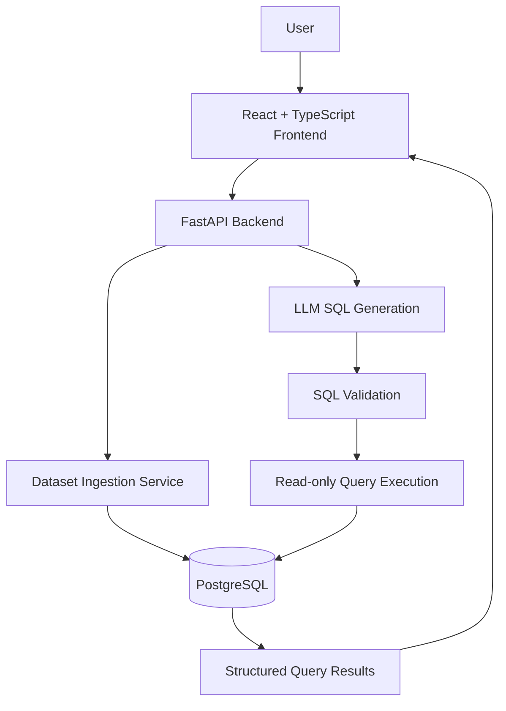

# DataPilot AI — AI-Powered Analytics Platform

DataPilot AI is a full-stack analytics application that allows users to upload datasets and explore their data using natural language.

Instead of manually writing SQL queries, users can ask business questions. The application uses an LLM to generate PostgreSQL queries, validates the generated SQL, executes approved queries against the database, and returns structured results.

## Project Overview

**Problem:** Business users and analysts often need SQL knowledge to extract insights from structured datasets.

**Solution:** DataPilot AI provides a natural-language interface for querying uploaded datasets while retaining SQL validation and controlled database execution.

## Features

- **Dataset ingestion:** Upload CSV and Excel files.
- **Automated profiling:** Inspect dataset structure, column types, null counts, unique values and statistical summaries.
- **Natural-language SQL generation:** Convert business questions into PostgreSQL queries using Groq-hosted LLMs.
- **SQL validation:** Validate generated SQL before execution.
- **Controlled execution:** Execute approved read-only queries against PostgreSQL.
- **Query results:** Return structured results with column metadata and generated SQL.
- **REST API:** Backend endpoints exposed through FastAPI and Swagger UI.

## Technology Stack

| Layer | Technologies |
|---|---|
| Frontend | React, TypeScript, Vite |
| Backend | Python, FastAPI |
| Database | PostgreSQL |
| ORM / Database access | SQLAlchemy |
| Data processing | Pandas |
| AI integration | Groq API, OpenAI-compatible SDK |
| SQL validation | SQLGlot |
| Testing | Pytest |
| Version control | Git, GitHub |

## Architecture



## Application Workflow

1. User uploads a CSV or Excel dataset.
2. Backend processes the file and profiles its columns.
3. Dataset metadata and data are stored in PostgreSQL.
4. User submits a natural-language business question.
5. The LLM generates a PostgreSQL query using the dataset schema.
6. SQL validation checks the generated query against execution restrictions.
7. Approved SQL executes in a read-only database transaction.
8. Results are returned to the frontend.

## SQL Safety

Generated SQL is not executed blindly.

The application implements controls including:

- SELECT-only query validation.
- Single-statement validation.
- Dataset table and column restrictions.
- Rejection of unsupported query structures.
- Read-only database transactions.
- Query execution timeout.
- Maximum result-row limit.

These controls reduce the risk of unintended database modifications and unrestricted queries. They are application-level safeguards, not a replacement for database permissions and infrastructure security.

## Project Structure

```text
datapilot-ai/
│
├── backend/
│   ├── app/
│   │   ├── agent/
│   │   ├── api/
│   │   ├── core/
│   │   ├── database/
│   │   └── services/
│   ├── tests/
│   ├── requirements.txt
│   └── .env.example
│
├── frontend/
│   ├── public/
│   ├── src/
│   ├── package.json
│   └── vite.config.ts
│
├── datasets/
├── docs/
├── .gitignore
└── README.md
```

## Run Locally

### Prerequisites

- Python 3.13+
- Node.js and npm
- PostgreSQL
- Groq API key

### 1. Clone the repository

```bash
git clone https://github.com/asrar-e/datapilot-ai.git
cd datapilot-ai
```

### 2. Configure the backend

```bash
cd backend
python -m venv .venv
```

Activate the environment on Windows:

```powershell
.\.venv\Scripts\Activate.ps1
```

Install dependencies:

```bash
pip install -r requirements.txt
```

Create your `.env` file using `.env.example` and configure your PostgreSQL connection and Groq API key.

### 3. Start the backend

From the backend directory:

```bash
python -m uvicorn app.main:app --reload
```

API documentation:

http://127.0.0.1:8000/docs

### 4. Start the frontend

Open a separate terminal:

```bash
cd frontend
npm install
```

Create `frontend/.env.local`:

```env
VITE_API_BASE_URL=http://127.0.0.1:8000
```

Start the development server:

```bash
npm run dev
```

Frontend:

http://localhost:5173

### 5. Run backend tests

From the backend directory with the virtual environment activated:

```bash
pytest -v
```

## API Endpoints

| Method | Endpoint | Purpose |
|---|---|---|
| GET | `/datasets` | List datasets |
| POST | `/datasets/upload` | Upload a dataset |
| GET | `/datasets/{dataset_id}/profile` | Retrieve dataset profile |
| POST | `/datasets/{dataset_id}/generate-sql` | Generate SQL |
| POST | `/datasets/{dataset_id}/execute-sql` | Validate and execute SQL |
| POST | `/datasets/{dataset_id}/ask` | Complete natural-language query workflow |

Interactive API documentation is available at `/docs` when the backend is running.

## Environment Variables

Keep credentials in local environment files. Never commit actual API keys, passwords or database credentials.

See `backend/.env.example` for the backend configuration template.

## Roadmap

- [x] FastAPI backend
- [x] PostgreSQL integration
- [x] CSV and Excel ingestion
- [x] Dataset profiling
- [x] LLM-powered SQL generation
- [x] SQL validation and controlled execution
- [x] React frontend integration
- [ ] Interactive data visualisations
- [ ] Docker and Docker Compose
- [ ] AWS deployment
- [ ] S3-based dataset storage
- [ ] RDS PostgreSQL
- [ ] ECS Fargate deployment
- [ ] GitHub Actions CI/CD
- [ ] CloudWatch monitoring

## Deployment

AWS deployment is planned. The target architecture includes Amazon S3, CloudFront, ECR, ECS Fargate, Application Load Balancer, RDS PostgreSQL, Secrets Manager and CloudWatch.

Deployment documentation and a live application link will be added after implementation.

## Author

**Asrar**

GitHub: https://github.com/asrar-e

---

*DataPilot AI is an engineering portfolio project focused on full-stack development, data engineering, LLM integration, SQL safety and cloud deployment.*